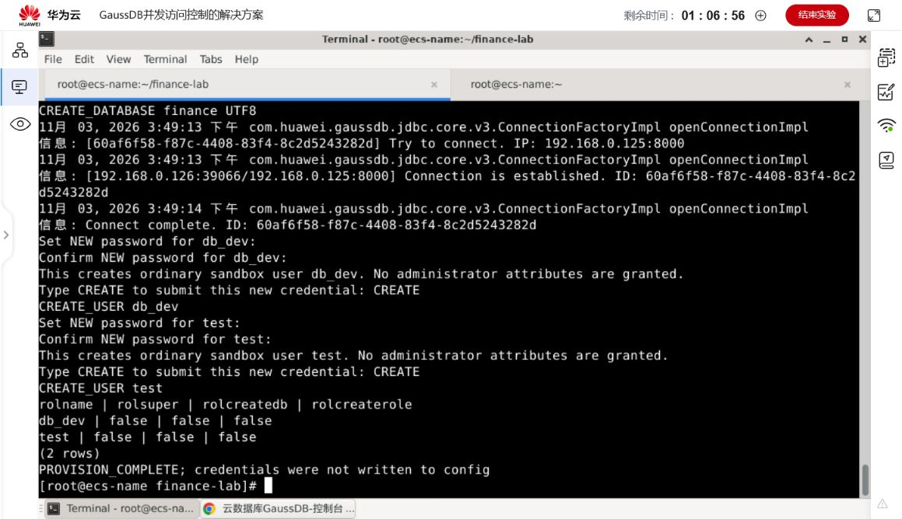
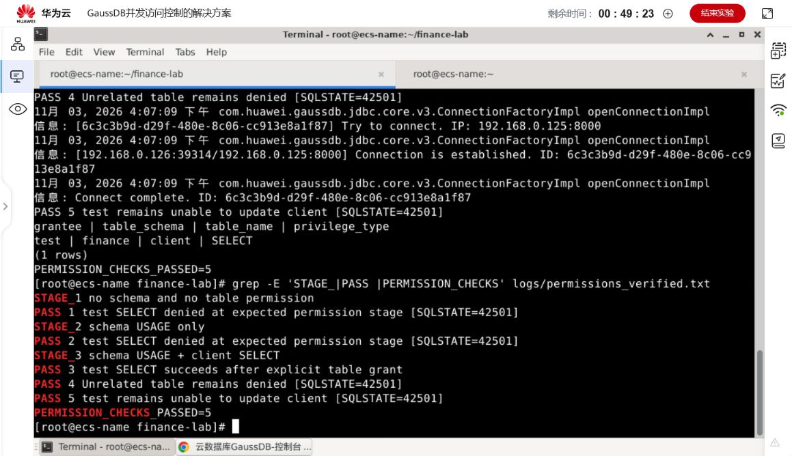
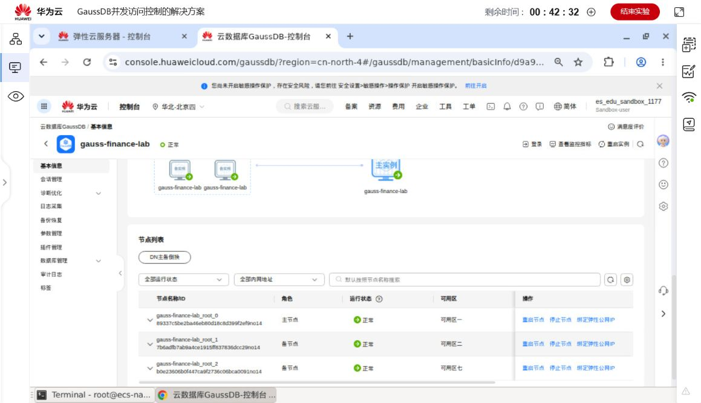
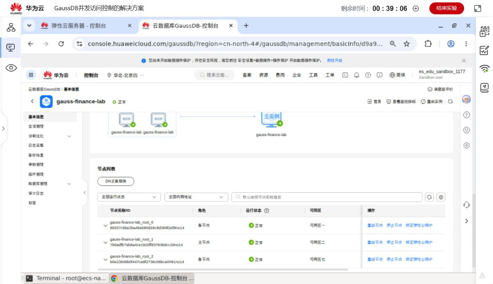
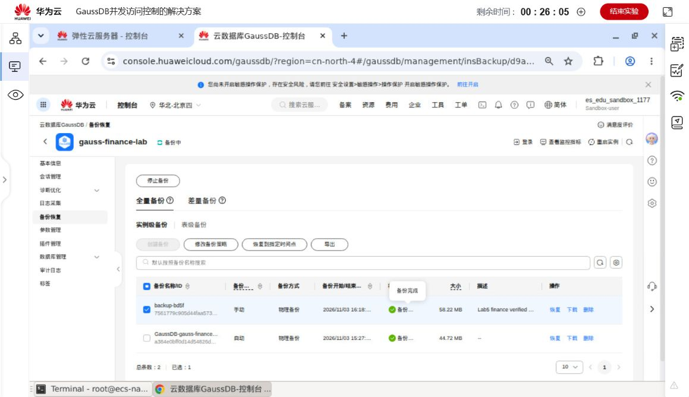
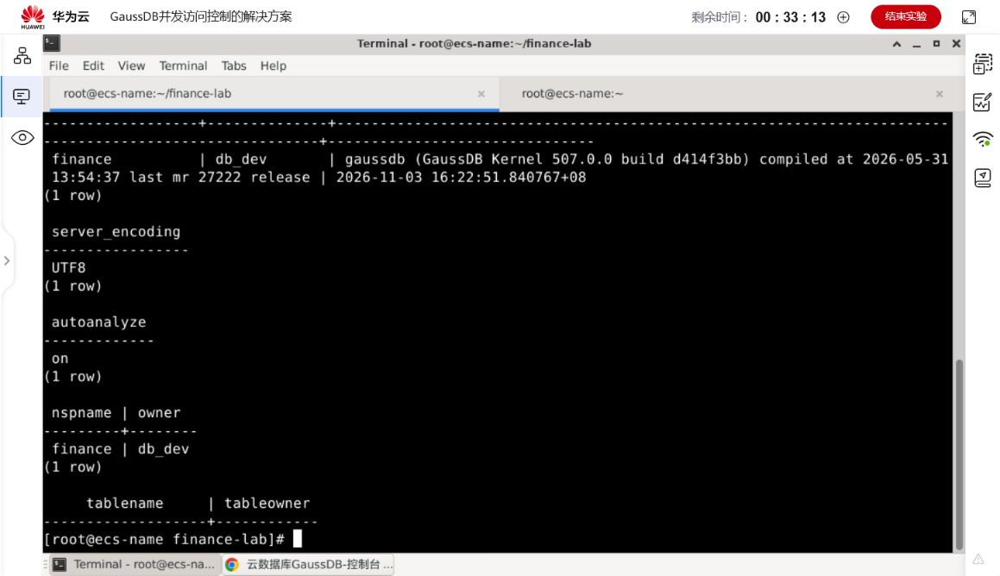

# 实验五操作记录与总结

## 目标与环境

完成金融业务的数据建模、JDBC 访问、客户及资产业务，并通过数据库约束、事务及独立查询验证结果。环境为北京四 GaussDB 集中式 1 主 2 备、4 vCPU / 16 GB、40 GB；客户端为同 VPC 的 CentOS 7.6.1810 x86_64，JDK 11.0.10+9 和官方 JDBC、gsql。

实测数据库地址 `192.168.0.125:8000`，ECS 私网地址 `192.168.0.126`，数据库和模式均为 `finance`、编码 UTF8。地址属于本次临时环境，复现时使用当前控制台地址。内核、驱动标识与配置方法见[首页](../README.md#环境与运行)。

班级、姓名、学号、成员分工：待填写。

## 关键步骤与结果

1. 安装官方工具与 JDK，校验驱动摘要，编译全部 Java。环境记录见 [client_environment.txt](../logs/cloud/client_environment.txt)。
2. 用 root 创建 UTF8 数据库及两个普通用户，创建归属 `db_dev` 的模式。初始化完成截图核对普通用户没有管理员、建库或建角色权限。
3. 以普通用户执行建表和初始化。保留四张业务表与讲义数据，增加唯一约束、外键、取值约束和业务索引；扩展请求与事件表。
4. DAO 测试检查增删改查的真实影响行数、0 行返回，以及 `23505`、`23503`、`23514` 约束错误。测试事务回滚。
5. 通过 Service 执行开户、修改、开卡、申购、赎回、销卡、销户；补充非法参数、不存在对象、错误所属者、冻结持仓及禁止销户检查。
6. 对资产写入与事件写入之间注入异常，确认资产、请求、事件均无残留；验证重放、参数冲突及真实并发。
7. 用独立期望值验证三类报表，再导出 CSV。临时报表数据在 finally 中回滚，原始四表仍为 10/10/4/4。
8. 验证普通用户三阶段权限、主备倒换、备份策略和手动备份、autoanalyze 参数及系统表与索引。
9. 以新 JDBC 连接比较六张表的完整有序快照，再通过独立 gsql 核对。菜单演示查询与报表，正常退出。

*数据库、模式和普通用户已创建；权限标志由实际 SQL 输出核验。*

## 管理与运维记录

### 权限

普通 `test` 用户无模式权限时查询失败；仅授予模式 USAGE 后，仍无表 SELECT 权限；授予 `finance.client` 的 SELECT 后读取 10 行成功，其他表查询及 UPDATE 仍以 `42501` 被拒绝。共 5 项检查通过。

### 主备倒换

倒换前 `root_0` 为主，`root_1`、`root_2` 为备。执行 DN 倒换后 `root_1` 为主，其他节点为备且均正常。程序使用原浮动地址重新建立连接，在 REPEATABLE READ 事务中按主键排序导出六张表的全字段 CSV，逐字节比较及 SHA-256 全部一致。

快照和摘要见 [before_switch](../data/before_switch)、[after_switch](../data/after_switch) 和 [snapshot_verification.json](../data/snapshot_verification.json)。

### 备份与参数

自动备份策略保存后重新读取确认：保留 5 天，周六、周日，03:00—04:00（GMT+08:00）。手动备份 `backup-bd5f` 于 2026-11-03 16:18:46 开始、16:21:05 完成，大小 58.22 MB。

`autoanalyze` 从 off 改为 on，参数任务显示成功并已应用。独立 gsql 的 `SHOW autoanalyze` 返回 on，`SHOW server_encoding` 返回 UTF8，并核对模式、表、索引及最终数据。

## 问题排查与修正

| 问题 | 分析与处理 | 结果依据 |
| --- | --- | --- |
| 官方环境脚本路径检查失败 | 明确设置 JAVA_HOME、PATH、LD_LIBRARY_PATH、GS_KTOOL_FILE_PATH | [安装脚本](../scripts/setup.sh)、环境记录 |
| 报表夹具的 `DATE '2018-07-31'` 解析报错 | 当前实例的日期格式有兼容差异，改为 PreparedStatement 绑定 `java.sql.Date` | [ScenarioTest.java](../src/expt/db/finance/ScenarioTest.java)、[首轮日志](../logs/cloud/cloud_acceptance.txt) |
| 日期直接转文本并截取月份得到错误分组 | 改用 `TO_CHAR(a_purchase_time,'YYYY-MM')` 显式格式化 | [report_month.sql](../scripts/report_month.sql)、[最终报表日志](../logs/cloud/cloud_reports_verified.txt) |
| 用户认证输入错误 | 分开核对 db_dev 与 test 的认证，认证成功后再执行授权验证 | 初次日志及 [通过日志](../logs/cloud/permissions_verified.txt) |

为避免重做已提交的业务，报表修正后使用 `resume-reports` 从报表夹具继续。该动作仅用于当时的中间状态；首次完整复现使用 `acceptance`。保留最初报错、中间重试和最终通过记录，各阶段计数不简单相加。

## 总结与边界

完整流程将数据库约束、参数校验、JDBC 返回值、跨表事务和运维交叉核对结合。关键改进包括：拒绝将影响 0 行当作成功；请求号与业务参数绑定；并发操作统一锁顺序；多表汇总先确定粒度；日期区间使用半开边界。

六张表的完整快照和独立 gsql 为程序断言提供交叉依据。申购与赎回事件在持仓删除或客户销户后继续保留。系统按教学整数金额实现，不包含真实收益核算、保险或基金业务；月度报表只统计当前持仓。进一步应用可增加金额精度与币种、连接池、角色分工及更细的审计查询。

字段、原始数据及基础流程来源于《GaussDB案例》案例五，程序扩展与评价对应见[进阶实现](进阶实现.md)。
