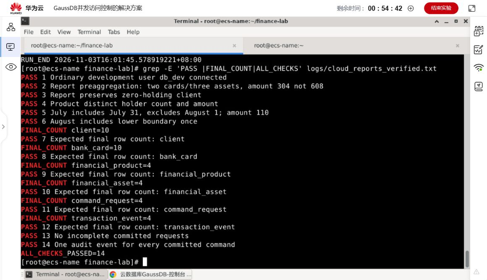
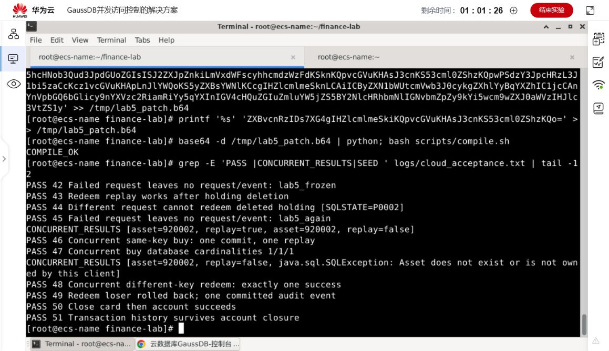

# 两项进阶实现说明

## 一、数据查询与分析

### 目标及改进价值

基础菜单的客户或产品查询只能返回单项信息。扩展为客户资产、产品持仓和按月统计，提供可比较、可导出的结果；重点解决银行卡与资产同时关联时金额被重复累加的问题。

### 设计与范围

1. 卡表按客户预聚合，资产表也按客户预聚合，再 LEFT JOIN 到客户。COALESCE 将无持仓的空值补为 0。
2. 产品报表分别统计资产条数与不同客户数，列出总金额、收益及冻结金额。
3. 月度报表绑定起止日期，以 `[start,end)` 过滤，用 `TO_CHAR` 明确月份格式。
4. 菜单 11—13 和 Reports 入口共用相同 SQL；输出 UTF-8 CSV，并处理文本单元格的公式前缀。

报表针对当前持仓，不将其表述为包含全部赎回记录的历史流水。原始整数金额及收益口径沿用讲义。

### 测试与效果

| 场景 | 独立期望值 | 实测 |
| --- | --- | --- |
| 客户 1 增加一张卡、两项资产 | 2 卡、3 资产，金额 304，收益 8017，可用 104、冻结 200 | 通过；没有放大为 608 |
| 客户 10 无持仓 | 仍返回客户，资产数及金额为 0 | 通过 |
| 产品 1 被同一客户持有多项 | 不同客户数为 1，资产数为 3，金额 304 | 通过 |
| 7 月半开区间 | 包含 7 月 31 日，排除 8 月 1 日；5 笔、金额 110、收益 32017 | 通过 |
| 8 月半开区间 | 包含下界 8 月 1 日；1 笔、金额 200 | 通过 |

测试夹具在事务中增加数据并最终回滚。原始月度报表仍为 4 笔、4 客户、金额 10、收益 32010；客户与产品报表分别为 10 行和 4 行。

**代码与结果位置：** [Reports.java](../src/expt/db/finance/Reports.java)、[report_client.sql](../scripts/report_client.sql)、[report_product.sql](../scripts/report_product.sql)、[report_month.sql](../scripts/report_month.sql)、[ScenarioTest.java](../src/expt/db/finance/ScenarioTest.java) 的 `reportFixture`、[云端通过日志](../logs/cloud/cloud_reports_verified.txt)、[CSV 数据目录](../data)。

## 二、数据正确性与可靠性

### 目标及改进价值

申购和赎回同时涉及业务数据、请求结果与事件记录。需要避免失败只写入一部分、用户重复提交生成重复交易、并发赎回同一持仓，以及检查可销户后又新增银行卡或持仓的竞争。

### 设计与实现

- **事务边界**：READ COMMITTED；请求、持仓和事件成功后统一 commit，任一异常 rollback。
- **请求幂等**：`command_request.request_id` 唯一；完整参数计算 SHA-256。相同请求同参数重放原编号，不同参数或动作拒绝。
- **约束错误分类**：仅请求插入发生 `23505` 时进入重放分支，其他业务主键冲突正常失败。回滚冲突事务后，读取已提交请求并核对状态及摘要。
- **锁顺序**：业务统一先锁客户，再锁定或变更持仓。开卡、销卡、申购、赎回和销户遵守相同顺序。
- **持久事件**：赎回按基础要求删除持仓，事件表保留交易快照，不级联删除历史。

### 测试与结果

| 场景 | 实际结果 |
| --- | --- |
| 资产插入后、事件写入前注入 `P0001` | 资产、请求、事件全部 0 条，无部分提交 |
| 相同申购请求及参数重放 | 返回原资产编号；仅一条资产和一条事件 |
| 相同请求号改变金额、日期或动作 | 拒绝，未产生额外交易 |
| 两线程相同请求号申购 | 一笔提交、一笔重放；资产／请求／事件各 1 条 |
| 两线程不同请求号赎回同一资产 | 仅一笔成功，另一笔 `P0002`；失败请求回滚 |
| 冻结资产、错误所属者、带卡或带资产销户 | 按业务规则拒绝 |
| 正常赎回与销户结束 | 临时客户和持仓清理，4 条成功交易事件保留 |

并发测试由两个线程各自创建独立 JDBC 连接，以 CountDownLatch 同时起跑，并使用数据库最终计数检查结果。

**代码与证据位置：** [Service.java](../src/expt/db/finance/Service.java)、[ScenarioTest.java](../src/expt/db/finance/ScenarioTest.java)、[请求及事件建表 SQL](../scripts/01_schema.sql)、[原始业务日志](../logs/cloud/cloud_acceptance.txt)、[最终快照](../data/after_switch)。

## 三、与进阶评价的对应

| 评价维度 | 体现 |
| --- | --- |
| 复杂性与技术深度，8 分 | 跨表事务、唯一约束、参数摘要、锁顺序、真实并发，以及多表聚合粒度和日期边界 |
| 新颖性与改进价值，6 分 | 针对重复提交、部分写入、销户竞争和金额重复求和提出可验证改进；修正 0 行仍报成功的问题 |
| 全面性与验证充分性，6 分 | 完整业务闭环，正常与异常路径、故障注入、重放冲突、真实并发、报表期望值、独立 gsql 及主备切换后快照交叉核对 |

两项方向形成实际实现与验证流程，评价依据是完成质量，不将两项方向简单各计 10 分。各阶段验收含重复核对，不累加为独立测试总数。
